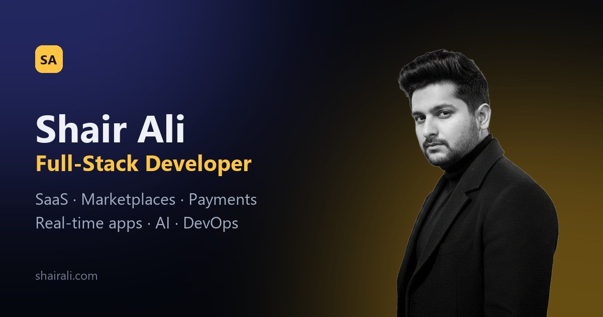
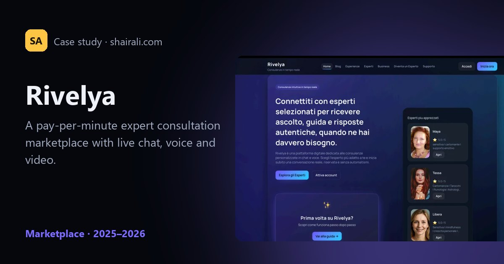
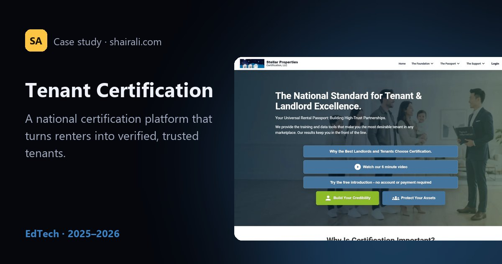
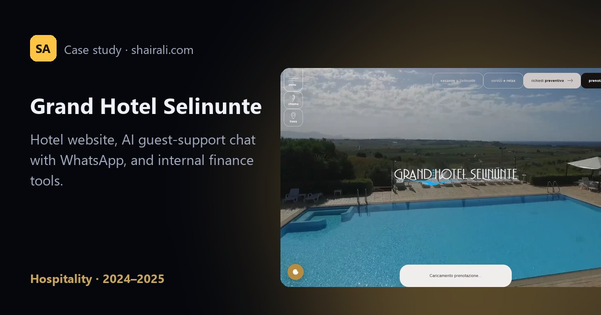

## Hi, I'm Shair Ali 👋

I'm Shair Ali, a solo full-stack and AI developer for founders and growing businesses in the USA and Europe. I build new products, finish half-built and AI-generated apps, and deploy them on servers I keep running.

I plan the architecture, design the interface, write the frontend and the API, model the data, wire up payments and third-party services, and then deploy and operate everything on Linux servers with automated CI/CD.

   

<table>
<tr>
<td align="center" width="20%"><h3>100%</h3>Solo delivery, from design to DevOps</td>
<td align="center" width="20%"><h3>US · EU</h3>Clients in the USA & Italy</td>
<td align="center" width="20%"><h3>3+ years</h3>Freelancing on Fiverr</td>
<td align="center" width="20%"><h3>Level 1</h3>Fiverr seller</td>
<td align="center" width="20%"><h3>4.9★</h3>Average rating on Fiverr</td>
</tr>
</table>

## 🚀 Featured work

A few of the larger platforms I've designed and built on my own for clients. The client code is private, so each one has a showcase repo with screenshots, architecture and the full stack.

<table>
<tr>
<td width="50%" valign="top">

<h3><a href="https://github.com/shairalidev/rivelya-showcase">Rivelya</a></h3>
Marketplace · Rivelya · Italy · Nov 2025 – Apr 2026

A pay-per-minute expert consultation marketplace with live chat, voice and video.

<b>1,250+</b> commits, all mine · <b>180+</b> api endpoints

<a href="https://github.com/shairalidev/rivelya-showcase">Showcase</a> · <a href="https://www.rivelya.com">Live site</a> · <a href="https://shairali.com/work/rivelya">Case study</a>

</td>
<td width="50%" valign="top">

<h3><a href="https://github.com/shairalidev/cover-me-lien-services-showcase">Cover Me Lien Services</a></h3>
SaaS · CoverM Enterprise, LLC · California, USA · Mar 2026 – Oct 2026

A lien-compliance platform that helps California contractors protect their right to get paid.

<b>~40</b> api endpoints · <b>9</b> data models

<a href="https://github.com/shairalidev/cover-me-lien-services-showcase">Showcase</a> · <a href="https://covermelienservices.com">Live site</a> · <a href="https://shairali.com/work/cover-me-lien-services">Case study</a>

</td>
</tr>
<tr>
<td width="50%" valign="top">

<h3><a href="https://github.com/shairalidev/tenant-certification-showcase">Tenant Certification</a></h3>
EdTech · Stellar Properties Certification, LLC · USA · Oct 2025 – present

A national certification platform that turns renters into verified, trusted tenants.

<b>440+</b> commits as sole developer · <b>260+</b> api endpoints maintained

<a href="https://github.com/shairalidev/tenant-certification-showcase">Showcase</a> · <a href="https://tenantcertification.online">Live site</a> · <a href="https://shairali.com/work/tenant-certification">Case study</a>

</td>
<td width="50%" valign="top">

<h3><a href="https://github.com/shairalidev/grand-hotel-selinunte-showcase">Grand Hotel Selinunte</a></h3>
Hospitality · Grand Hotel Selinunte · Sicily, Italy · 2024 – 2025

Hotel website, AI guest-support chat with WhatsApp, and internal finance tools.

<b>3</b> products delivered · <b>24/7</b> ai guest support

<a href="https://github.com/shairalidev/grand-hotel-selinunte-showcase">Showcase</a> · <a href="https://grandhotelselinunte.com">Live site</a> · <a href="https://shairali.com/work/grand-hotel-selinunte">Case study</a>

</td>
</tr>
</table>

## 🛠️ Tech I use in production

**Frontend** 
     

**Backend** 
   

**Data** 
   

**Integrations** 
     

**Cloud & DevOps** 
      

## 🧩 What I do

- **SaaS & web platforms:** React, Next.js & Vue, Node.js / Express APIs, Admin dashboards & client portals
- **Payments & billing:** Stripe Checkout & Payment Intents, Wallets, credits & payouts, Refunds, disputes & audit trails
- **Real-time features:** Socket.io, WebRTC with LiveKit, Scheduling & live session timers
- **AI assistants & automation:** LLM chat (OpenAI, Groq, Gemini), WhatsApp integration, PDF, email & workflow automation
- **Cloud deployment & DevOps:** AWS EC2 & DigitalOcean, Nginx, PM2 & Cloudflare, GitHub Actions CI/CD
- **Legacy modernization:** Code audits & security hardening, Incremental refactors, Ongoing maintenance & support

## 📂 More projects

| Project | What it is | Stack |
|---|---|---|
| [BarberPro](https://github.com/shairalidev/BarberAppointments) | Booking system for a barber shop: 3-step booking, live availability, JWT admin dashboard. | Vue 3 · Node.js · Express · MongoDB |
| [UP&OUT](https://github.com/shairalidev/upandout) | Prototype that finds trending Dallas spots from Instagram Reels data and enriches them with AI. | Node.js · Express · OpenAI · Bright Data |
| [AI Talk](https://github.com/shairalidev/aitalk) | Faith-based AI chat app with language detection and speech output. | React · OpenAI · Gemini |
| [Video player plugin](https://github.com/shairalidev/plugin) | Customisable HTML5 video player with a side menu. | HTML5 · JavaScript |
| [Whale Squares](https://github.com/shairalidev/WhaleSquaresSolana) | React and Tailwind front end for Whale Squares on Solana. | React · Tailwind CSS · Solana |
| [Estimate calculator](https://github.com/shairalidev/calculate_estimmate) | Quote and estimate calculator site. | JavaScript |

## ⭐ What clients say

**4.9★ average rating on fiverr · 12 client reviews · 3–4× repeat orders from the same clients** on [Fiverr](https://www.fiverr.com/sellers/devshair)

> I would be surprised if you find anyone more competent, intelligent, kind, and capable of doing all that was needed for my website. You have no need to look any further. Shair is the real deal!
>
> ★★★★★ K., United States · 4 orders

> He took on a project without seeing what he had to work with and successfully completed it under limited information from me because I am not a programmer. He went out of his way to communicate and explain what I did not understand and has set us up to work together in the future.
>
> ★★★★★ P., United States · 4 orders

> Built the perfect platform for my barber booking tool.
>
> ★★★★★ M., Austria · 3 orders

> What sets him apart is his ability to listen carefully, understand the needs of individuals with limited technical or programming knowledge, and translate those needs into practical, effective solutions.
>
> ★★★★★ K., United States · 4 orders

## 🎓 Education

**BS Computer Science**, Riphah International University, Lahore Campus (Fall 2019 – Spring 2023) · CGPA 3.75 / 4.00 
🏆 Academic excellence award, RSCI Annual Gala · [references and documents](https://shairali.com/achievements)

---

Need a platform built, finished or deployed? <a href="https://shairali.com/contact"><b>Let's talk</b></a>.

